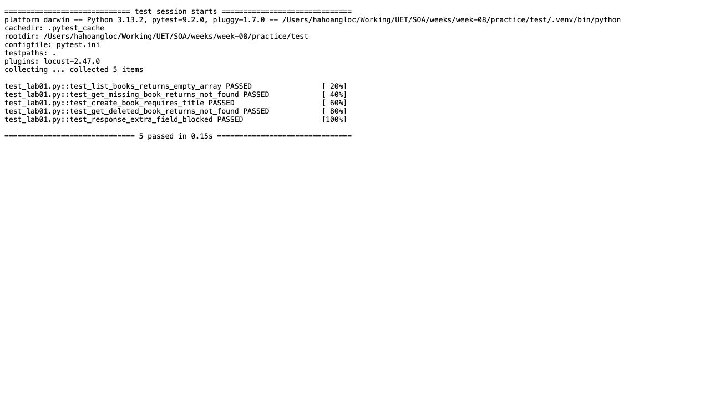
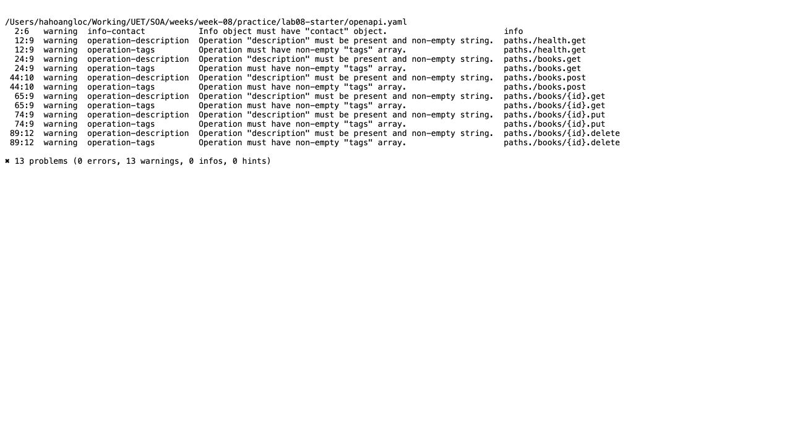
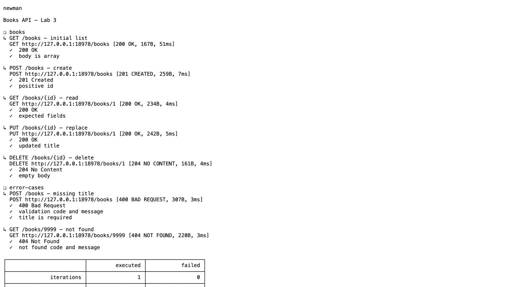
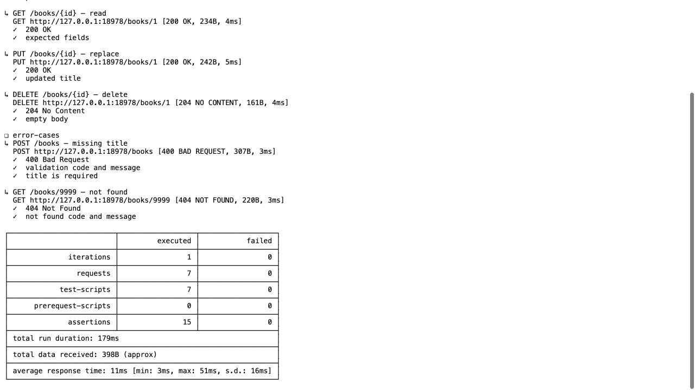
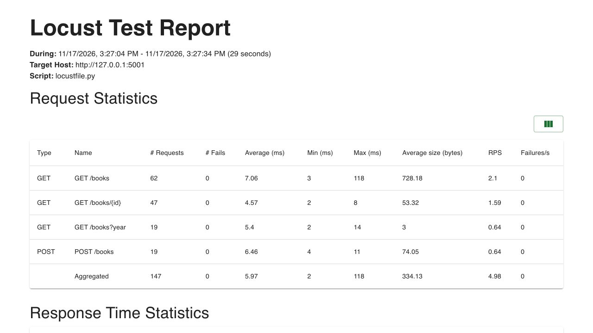
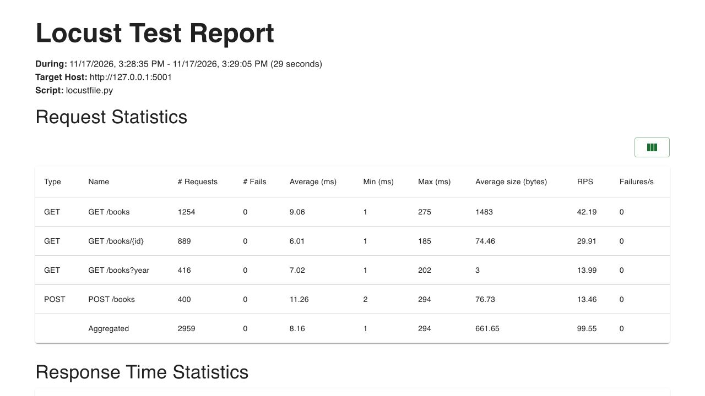

# Week 08 — API Testing

## Lab 1 — pytest

Minh chứng chạy: **5/5 test đạt**. [File đầu ra](evidence/lab1-pytest.txt).



## Lab 2 — OpenAPI / Spectral

Ba lỗi trong đề đã được sửa trong `lab08-starter/openapi.yaml`: 
- Thêm `operationId` cho `GET /books`.
- Bỏ body khỏi response 204 của DELETE.
- Khai báo `Book.year` là integer. 

Custom rule `response-200-has-fields` kiểm tra schema response 200 có trường; một bản sao với schema rỗng đã bị rule báo lỗi.

Chạy từ `spectral/`:

```sh
npm ci
./node_modules/.bin/spectral lint ../lab08-starter/openapi.yaml --ruleset .spectral.yaml --fail-severity error
```

Kết quả đã lưu: **0 errors, 13 warnings**. Xem [đầu ra Spectral](spectral/reports/spectral.txt), [thử nghiệm rule](spectral/reports/custom-rule-negative.txt)



## Lab 3 — Postman / Newman

Khởi động API rồi chạy collection từ `Postman/`: **7 requests, 15 assertions, 0 failures**. [Đầu ra Newman](Postman/reports/newman.txt) và [JUnit](Postman/reports/junit.xml) do công cụ tạo.





## Lab 4 — Locust

Locust mô phỏng các tác vụ đọc danh sách, đọc theo ID, tìm theo năm và tạo sách. Trường hợp 404 dự kiến khi đọc ID ngẫu nhiên được tính là thành công; không tạo lỗi giả lập. Ba kịch bản đã chạy trên Flask development server và SQLite cùng máy::

| Kịch bản | Users / spawn mỗi giây | Thời lượng cấu hình | Requests | p95 tổng hợp | Failures | RPS trung bình |
|---|---:|---:|---:|---:|---:|---:|
| A | 10 / 2 | 30 giây | 147 | 10 ms | 0 | 4,98 |
| B | 50 / 5 | 60 giây | 1.390 | 11 ms | 0 | 23,28 |
| C | 200 / 50 | 30 giây | 2.959 | 41 ms | 0 | 99,55 |





